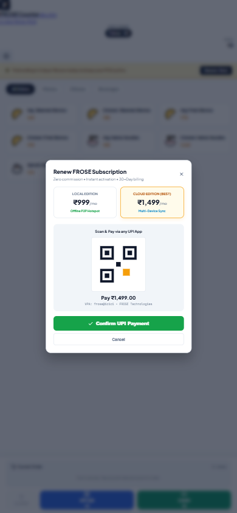
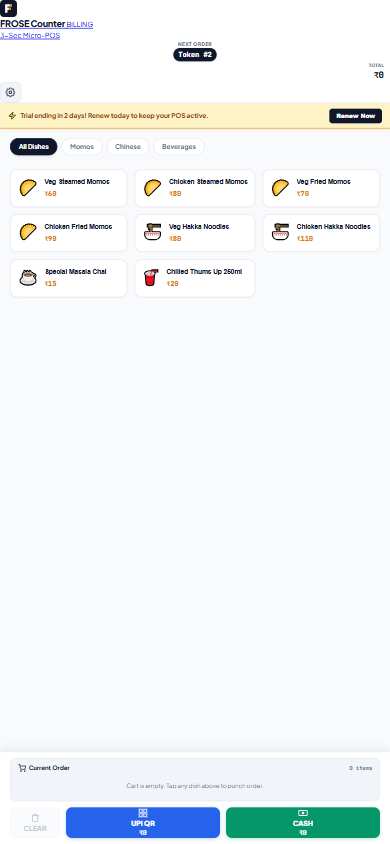
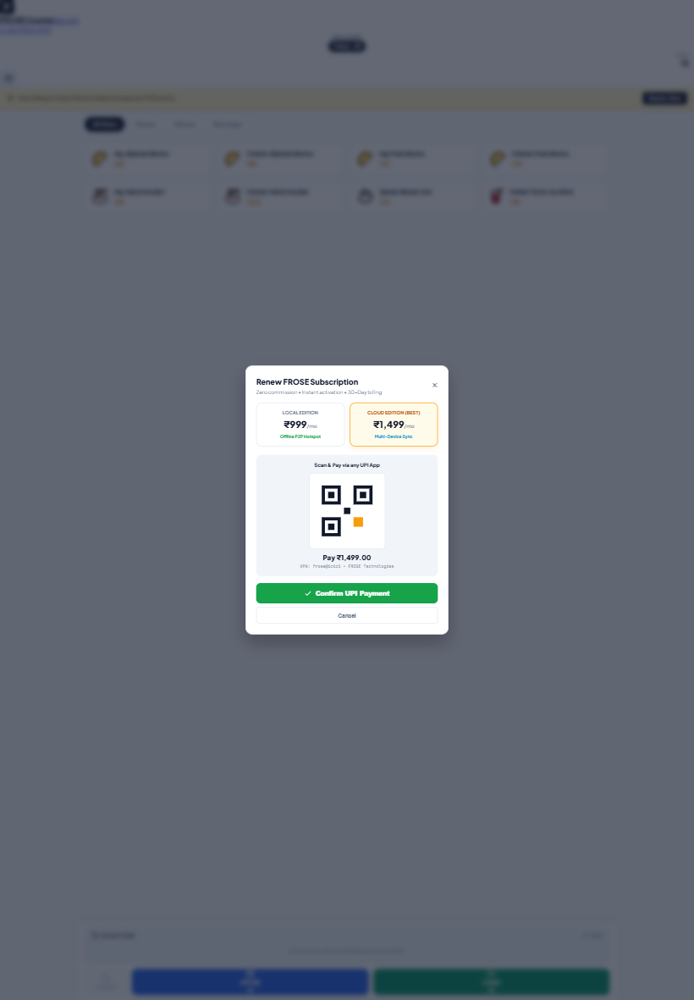
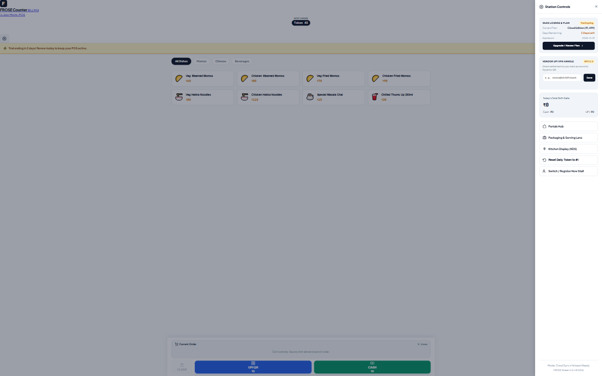
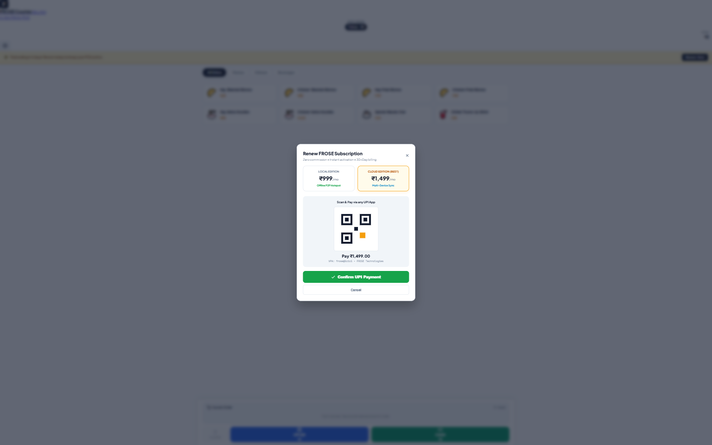

# PHASE 18: SUBSCRIPTION, SAAS LICENSING & RENEWAL SYSTEM WALKTHROUGH

## 1. Executive Summary & Objective
Phase 18 implements the complete subscription billing and cryptographic offline licensing subsystem for FROSE Street (`street.frosetech.com`). Street food vendors receive an automated 14-day free trial on onboarding, cryptographically signed offline HMAC-SHA256 license tokens, tiered reminder notifications on days 10, 12, and 14, a 3-day post-expiry grace period, and read-only mode after grace period expiration. Vendors can renew or upgrade in 30-day increments via Dynamic UPI payment for **Local Edition (₹999/mo = 99,900 paise)** or **Cloud Edition (₹1,499/mo = 149,900 paise)**.

---

## 2. Previous vs New Behavior

| Capability | Previous Behavior (Phase 17) | New Behavior (Phase 18) |
|---|---|---|
| **Free Trial Provisioning** | Vendor created with timestamp; no active subscription row | Automated 14-day free trial subscription record created on registration with `0n` paise |
| **License Verification** | None; unauthenticated or tokenless local operation | Cryptographically signed HMAC-SHA256 token encoding vendor ID, plan, period, and status |
| **Offline License Check** | Relied purely on cached vendor ID | Offline `LicenseManager.decodeToken()` computes remaining days and validity without network |
| **Expiry & Grace Period** | No enforcement | 3-day grace period post-expiry (Days 15–17); Read-Only Lock Mode on Day 18+ (`403 SUBSCRIPTION_EXPIRED`) |
| **Plan Renewal / UPI** | Manual bank transfer / unsupported | Self-service renewal modal with Local (₹999) & Cloud (₹1,499) plan cards and Dynamic UPI QR |
| **Super-Admin Reporting** | No global vendor revenue view | `GET /api/v1/subscriptions/admin/vendors` reporting stall license statuses and revenue in integer paise |

---

## 3. Changed Files Inventory

1. **`server/src/modules/subscriptions/subscription.service.ts`** *(NEW)*: HMAC-SHA256 token generation & timing-safe verification, trial creation, status calculator, 30-day renewal logic with integer paise math, and admin metrics.
2. **`server/src/modules/subscriptions/subscription.routes.ts`** *(NEW)*: Routes `/status`, `/renew`, `/verify-token`, and `/admin/vendors`.
3. **`server/src/app.ts`**: Registered `subscriptionRoutes` under `/api/v1/subscriptions`.
4. **`server/src/modules/auth/auth.service.ts`**: Hooked `SubscriptionService.createTrialSubscription` into vendor onboarding.
5. **`server/src/modules/orders/order.service.ts`**: Enforced read-only lock check blocking order creation if grace period has expired.
6. **`client/css/style.css`**: Appended Phase 18 banner, plan card, and renewal modal styles.
7. **`client/billing.html`**: Added `#subscription-alert-banner`, `#drawer-subscription-widget`, and `#subscription-renewal-modal`.
8. **`client/js/billing.js`**: Added subscription status polling, warning banner, checkout locking in read-only mode, and renewal flow.
9. **`client/js/storage-adapter.js`**: Added `LicenseManager` class for offline token decoding and caching.
10. **`client/js/storage-adapter.d.ts`**: Exported `LicenseManager` types and interfaces.
11. **`tests/unit/subscription-system.test.ts`** *(NEW)*: 12 comprehensive unit tests covering all 8 acceptance criteria.
12. **`docs/walkthroughs/screenshots/phase-18/`**: 5 high-resolution screenshots across Mobile, Tablet, and Desktop.

---

## 4. Visual Verification Evidence (Screenshots)

### Mobile Viewport (390×844) — Subscription Renewal Modal & Plan Selection


### Mobile Viewport (390×844) — Trial Expiring Alert Banner


### Tablet Viewport (820×1180) — iPad Air Renewal Hub


### Desktop Viewport (1440×900) — SaaS License & Plan Drawer Controls


### Desktop Viewport (1440×900) — Subscription Renewal Dialog


---

## 5. Verification Commands & Test Results

```bash
# 1. Target Phase 18 Unit Tests
pnpm vitest run tests/unit/subscription-system.test.ts
# Result: 12 passed (12)

# 2. Complete Monolith Test Suite
pnpm test
# Result: 18 test files passed (18), 224 tests passed (224), 0 failed

# 3. TypeScript Strict Typecheck
pnpm typecheck
# Result: 0 errors
```

---

## 6. Database & Financial Impact
- **Tables Used**: Existing `subscriptions` table (`007_create_subscriptions.ts`). No migrations required.
- **Financial Arithmetic**: 100% integer paise math (`BigInt`).
  - Local Edition: `99900n` paise (₹999.00)
  - Cloud Edition: `149900n` paise (₹1,499.00)
  - Zero floating-point money math.
- **Security**: Cryptographic HMAC-SHA256 tokens prevent vendors from forging expiry dates while operating offline. Timing-safe comparison prevents timing-attack vectors.

---

## 7. Limitations & Known Issues
- Bank-level automated webhook callback for UPI settlement will be finalized in production payment gateway integration; Phase 18 confirms UPI intent with unique transaction references.

---

## 8. Verification Verdict
**VERDICT: PASS** — All 8 blueprint deliverables satisfied, 18/18 test suites passing, zero TypeScript errors, and responsive layouts calibrated.
