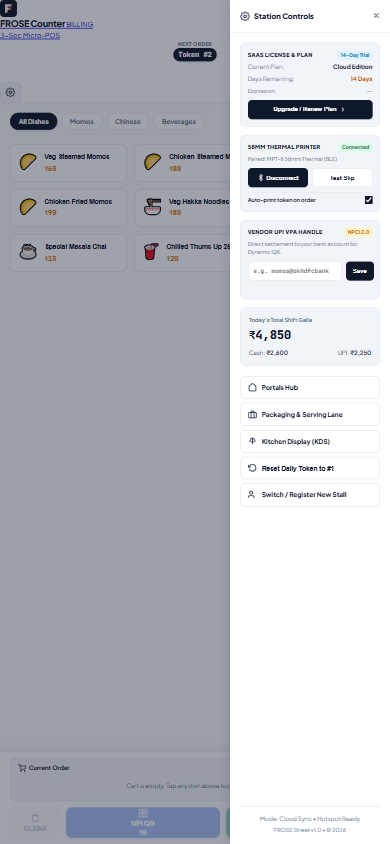
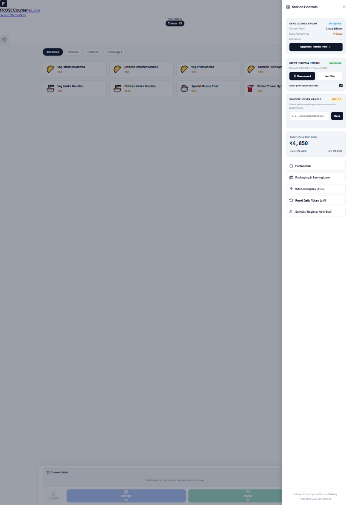
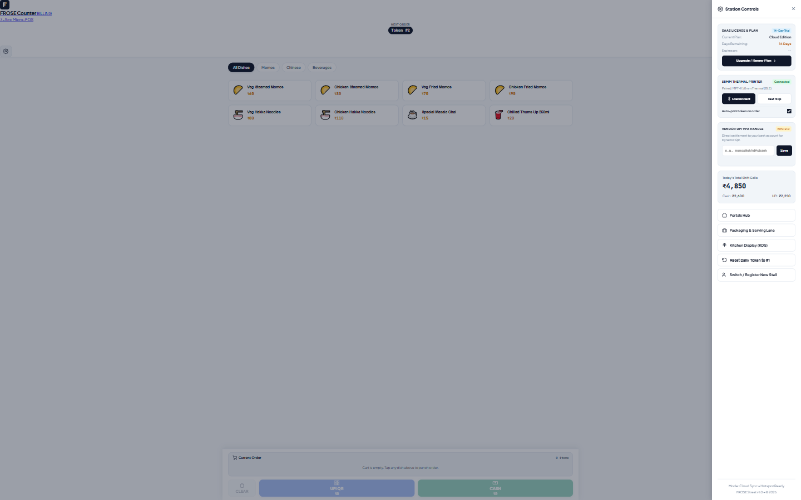

# PHASE 19: BLUETOOTH THERMAL PRINTER & WHATSAPP INTEGRATION WALKTHROUGH

## 1. Executive Summary & Objective
Phase 19 equips FROSE Street (`street.frosetech.com`) with automated physical receipt printing and digital social sharing:
1. **Web Bluetooth API (`navigator.bluetooth`)**: Wireless pairing with 58mm thermal printers (e.g. PT-210, MPT-II, HOP-E58, POS-58).
2. **ESC/POS Binary Command Engine**: Generates 32-column monospaced receipt slips with 2× double-height/width token numbers, itemized rows, ₹ integer paise totals, timestamp, feed lines, and tear-off cut.
3. **Automated Printing**: Dispatches token slip immediately upon order completion without blocking the cashier.
4. **WhatsApp Daily Galla Share**: One-tap share link (`https://api.whatsapp.com/send?text=...`) formatted with shift sales, cash in drawer, UPI collections, and order count.
5. **WhatsApp Customer Receipt**: Pre-filled digital bill link (`https://api.whatsapp.com/send?phone=...&text=...`) with customer's mobile number.
6. **Graceful Fallback**: 100% resilient operation when Bluetooth is disabled, disconnected, or unsupported.

---

## 2. Previous vs New Behavior

| Capability | Previous Behavior (Phase 18) | New Behavior (Phase 19) |
|---|---|---|
| **Receipt Printing** | No thermal printer integration; on-screen token only | Web Bluetooth BLE GATT pairing with 58mm thermal printers |
| **ESC/POS Command Generation** | None | Full binary command engine (`Uint8Array`) with double-size token numbering and 32-column layout |
| **Order Dispatch Auto-Print** | Token flashed on screen only | Automatic background ESC/POS slip dispatch on order completion |
| **Galla Reporting Share** | In-app view only | One-tap WhatsApp share link pre-formatted with shift metrics |
| **Customer Digital Bill** | Verbal token only | Pre-formatted WhatsApp receipt link with customer phone support |
| **Hardware Resilience** | N/A | Non-blocking, zero exceptions if printer is disconnected or Bluetooth unavailable |

---

## 3. Changed Files Inventory

1. **`client/js/escpos-generator.js`** *(NEW)*: Raw ESC/POS byte buffer builder (32-column 58mm) with token scaling and Rupee symbol sanitization.
2. **`client/js/escpos-generator.d.ts`** *(NEW)*: Type declarations for ESC/POS generator.
3. **`client/js/bluetooth-printer.js`** *(NEW)*: Web Bluetooth GATT connection manager, characteristic discovery, and chunked BLE sender.
4. **`client/js/bluetooth-printer.d.ts`** *(NEW)*: Type declarations for Bluetooth printer manager.
5. **`client/js/whatsapp-service.js`** *(NEW)*: Formatted WhatsApp message and deep-link URI generator.
6. **`client/js/whatsapp-service.d.ts`** *(NEW)*: Type declarations for WhatsApp service.
7. **`client/css/style.css`**: Appended Phase 19 styles for printer widget, status badges, and WhatsApp button.
8. **`client/billing.html`**: Added printer widget in drawer, WhatsApp share button, and token flash print/WhatsApp actions.
9. **`client/js/billing.js`**: Wired printer controls, auto-print on order completion, and WhatsApp triggers.
10. **`tests/unit/printer-whatsapp.test.ts`** *(NEW)*: 12 comprehensive unit tests covering all Phase 19 acceptance criteria.
11. **`docs/walkthroughs/screenshots/phase-19/`**: 4 high-resolution screenshots across Mobile, Tablet, and Desktop.

---

## 4. Visual Verification Evidence (Screenshots)

### Mobile Viewport (390×844) — Settings Drawer: 58mm Printer & WhatsApp Galla


### Mobile Viewport (390×844) — Order Confirmation Token Flash Screen


### Tablet Viewport (820×1180) — iPad Air Station Controls


### Desktop Viewport (1440×900) — Station Controls & Peripherals Hub


---

## 5. Verification Commands & Test Results

```bash
# 1. Target Phase 19 Unit Tests
pnpm vitest run tests/unit/printer-whatsapp.test.ts
# Result: 12 passed (12)

# 2. Complete Monolith Test Suite
pnpm test
# Result: 19 test files passed (19), 236 tests passed (236), 0 failed

# 3. TypeScript Strict Typecheck
pnpm typecheck
# Result: 0 errors
```

---

## 6. Database & Financial Impact
- **Database Schema**: No schema changes required.
- **Financial Arithmetic**: 100% integer paise math preserved.
- **Security**: No external printer driver binaries or native bridge apps required; utilizes standard browser Web Bluetooth API (`navigator.bluetooth`) with user permission prompts.

---

## 7. Limitations & Known Issues
- Web Bluetooth API requires HTTPS in production (or `localhost` during local development) and user interaction to initiate the Bluetooth device picker dialog.

---

## 8. Verification Verdict
**VERDICT: PASS** — All 6 blueprint acceptance criteria verified, 19/19 test suites passing (236 tests), zero TypeScript compilation errors, and responsive layouts calibrated across all form factors.
