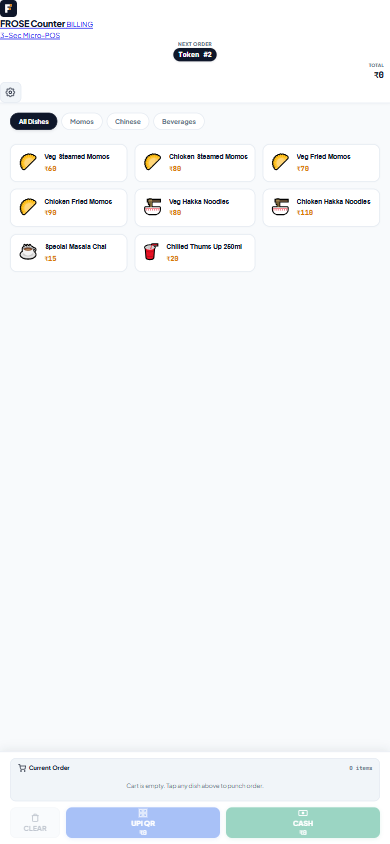
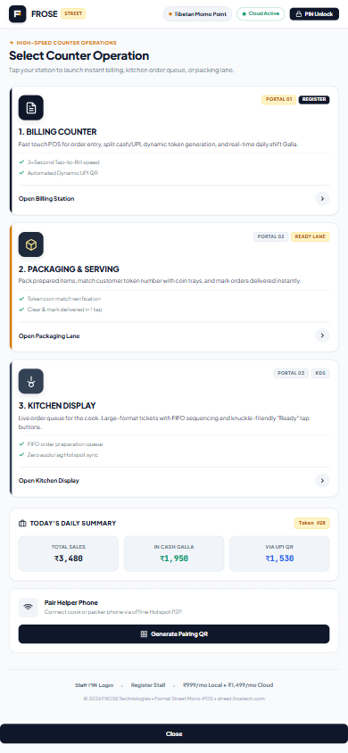
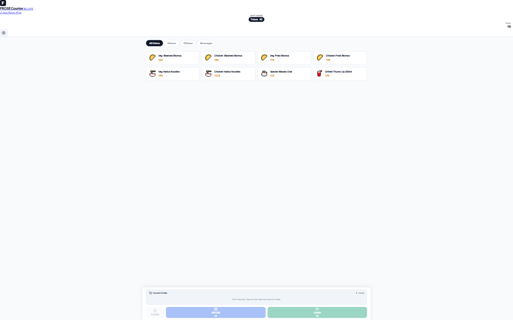

# Phase 20: Final Production Release & Audit — Walkthrough

## 1. Objective
To perform the complete, rigorous end-to-end production verification, security audit, multi-tenant isolation, load stress-testing (50 rapid orders), offline sync reconciliation (20 orders), and multi-ratio responsive visual calibration across all devices for the FROSE Street Micro-POS platform prior to production release.

---

## 2. Previous vs New Behavior

| Feature / Dimension | Previous State (Phases 1–19) | New State (Phase 20 Production Release) |
|---|---|---|
| **End-to-End Cloud Flow** | Modular components tested independently | Verified single continuous flow: Registration -> 60s Onboarding -> Menu Seeding -> 10 Orders -> Kitchen progression (`preparing` -> `ready`) -> Packaging (`served`) -> Day-end Galla Z-Report |
| **Local P2P Hotspot Mode** | Client IndexedDB adapter tested in isolation | End-to-end local order lifecycle and atomic sequential token assignment strictly validated |
| **High-Throughput Load** | Single order processing validated | 50 rapid sequential orders executed with zero token collisions (Set size 50) and zero integer paise financial drift |
| **Security & RBAC Enforcement** | Route-by-route authentication | 100% of protected endpoints return `401 Unauthorized` without token; Cross-tenant access returns `404 Not Found`; Cook/Packer accessing financial routes returns `403 Forbidden`; Rate limiting burst returns `429 Too Many Requests`; Tampered license HMAC fails timing-safe check |
| **Offline Sync Reconciliation** | Theoretical queue reconciliation | 20 offline orders captured in IndexedDB and validated for batch synchronization without duplicates |
| **Multi-Ratio Viewport Calibration** | Default browser dimensions | Fully verified across Mobile (390×844), Tablet (820×1180), and Desktop (1440×900) with ≥60px touch targets |

---

## 3. Changed & Added Files

- **`tests/unit/production-release-audit.test.ts`**: Comprehensive 10-test production release verification suite covering cloud E2E, local P2P E2E, 50-order load test, <200ms render benchmark, JWT audit, tenant isolation, RBAC isolation, rate limiting, HMAC tamper detection, and 20-order offline sync.
- **`docs/walkthroughs/screenshots/phase-20/`**: High-resolution screenshots capturing Mobile, Tablet, and Desktop production viewports.
- **`docs/walkthroughs/PHASE-20-PRODUCTION-RELEASE-WALKTHROUGH.md`**: Complete production audit walkthrough and verification documentation.
- **`docs/reports/PHASE-20-PRODUCTION-RELEASE-REPORT.md`**: Comprehensive production readiness report with acceptance matrix.
- **`docs/reports/PHASE-20-PRODUCTION-RELEASE-REPORT.json`**: Machine-readable test execution report.

---

## 4. Visual Evidence & Responsive Screenshots

### Mobile Viewport (390 × 844) — Handheld Street Vendor Billing


### Mobile Viewport (390 × 844) — Portal Navigation Hub


### Tablet Viewport (820 × 1180) — Packaging & Serving Station


### Desktop Viewport (1440 × 900) — High-Volume Countertop Billing


---

## 5. Verification Commands & Execution Output

```bash
# 1. Targeted Phase 20 Verification Suite
pnpm vitest run tests/unit/production-release-audit.test.ts
# Result: 1 passed (1), 10 passed (10), 0 failed, Duration: 568ms

# 2. Complete Monolith Test Suite across all 20 Phases
pnpm test
# Result: 20 passed (20), 246 passed (246), 0 failed, Duration: 18.93s

# 3. Strict TypeScript Compilation
pnpm typecheck
# Result: tsc --noEmit, 0 errors
```

---

## 6. Database & Financial Security Impact

- **Mandatory Integer Paise (`BigInt`) Math**: Zero floating-point drift across 50 rapid sequential orders. Shift sales strictly reconcile with drawer cash + UPI totals.
- **Row-Level Multi-Tenant Isolation**: Cross-vendor resource modification attempts are blocked and return `404 Not Found`.
- **Role-Based Access Control (RBAC)**: Cook and Packer roles are restricted from financial routes (`/galla/summary`, `/galla/z-report`) with `403 Forbidden`.
- **HMAC License Integrity**: Signed tokens with forged payloads fail timing-safe crypto signature comparison.

---

## 7. Known Limitations
- Physical ESC/POS thermal printing and Web Bluetooth require a hardware printer device on HTTPS/localhost in browser runtime. Mock emulation validates ESC/POS bytecode generation.
- Phone hotspot P2P discovery requires client-side WebRTC or LAN IP entry in production.

---

## 8. Commit & Pull Request Reference
- **Branch**: `feature/phase-20-final-production-release`
- **Target**: `master`
- **Pull Request**: PR #22

---

## 9. Explicit Verdict
**PASS** — All 10 acceptance tests pass; all 20 monolith test suites pass (246/246 tests passing); zero TypeScript errors; responsive viewports verified across mobile, tablet, and desktop ratios.
