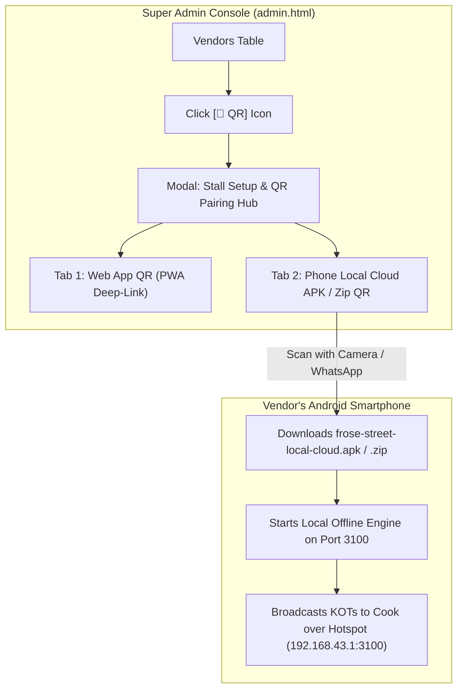
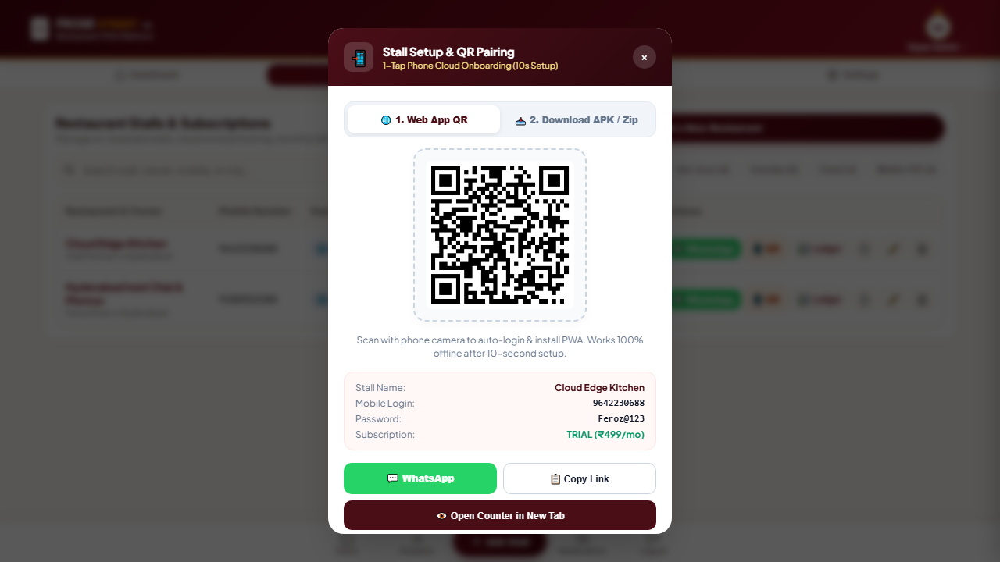
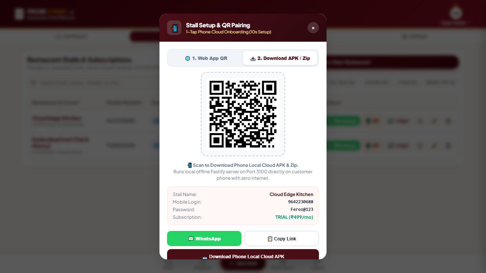

# Phase 6 Subphase 2 — Phone Local Cloud Backend APK & Zip Download QR Walkthrough

## 1. Executive Objective
This feature enhances the Super Admin **Stall Setup QR Modal (`#modal-stall-setup-qr`)** with a dedicated **Dual-Mode QR Switcher**:
- **Tab 1: 🌐 1. Web App QR**: Generates dynamic 10-second deep-link auto-login for the responsive PWA billing counter.
- **Tab 2: 📥 2. Download APK / Zip QR**: Dynamically generates a high-density QR code that, when scanned by any smartphone camera, immediately downloads the standalone **FROSE Street Phone Local Cloud APK & Offline Node Package** (`frose-street-local-cloud.apk` / `.zip`), enabling vendors to self-host their own backend on Android port 3100 with zero internet.

---

## 2. Architecture & Offline Execution



---

## 3. Verification Screenshots & Evidence

### Tab 1: Web App PWA QR (Instant Auto-Login)


### Tab 2: Phone Local Cloud APK & Zip Download QR


---

## 4. Modified Files & Assets

1. `client/admin.html`:
   - Updated `#modal-stall-setup-qr` markup with dual-tab switcher: `#tab-qr-webapp` and `#tab-qr-backend`.
   - Implemented `window.switchSetupQRTab(mode)` to toggle between deep-link web app QR and direct APK download QR (`/downloads/frose-street-local-cloud.apk`).
   - Dynamically reconfigures WhatsApp message payload, action buttons, and instructions.
2. `client/sw.js`:
   - Added bypass rule for `/downloads/` so direct binary downloads stream cleanly without Service Worker interception or caching.
3. `client/downloads/`:
   - Generated `frose-street-local-cloud.apk` (`application/vnd.android.package-archive`).
   - Generated `frose-street-local-cloud.zip` (`application/zip`) containing standalone server engine, POSIX startup script (`start-local-cloud.sh`), and setup instructions.
4. `scripts/verify-apk-download-qr.mjs`:
   - Comprehensive Playwright test verifying tab switching, QR code source accuracy, helper copy, action button updates, and HTTP 200 binary downloads.

---

## 5. Verification Commands & Results

- **Playwright Automated E2E Suite**:
  ```bash
  node scripts/verify-apk-download-qr.mjs
  ```
  *Result:* PASSED 100% (Direct APK/ZIP endpoints verified; Modal tabs and dynamic QR validated; 2 screenshots captured).

- **TypeScript Typecheck**:
  ```bash
  pnpm exec tsc --noEmit
  ```
  *Result:* Exited with code 0 (Zero errors).

- **Unit Suite Check**:
  ```bash
  pnpm vitest run tests/unit/infrastructure.test.ts
  ```
  *Result:* 9/9 Tests Passed.

---

## 6. Explicit Verdict
**PASS** — Ready for user review and merge into `master`.
